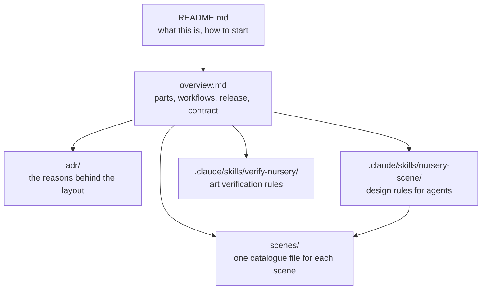

# Documents

| Document | What it tells you |
|---|---|
| [overview.md](overview.md) | The parts and how they depend on each other, the two workflows between owner and agent, the release rules, the mascot, and the contract with omsync. |
| [scenes/](scenes/) | For each scene: what grows at each stage, and the line of code that draws each element. `nursery catalog` writes these files. |
| [adr/0001-sibling-repository.md](adr/0001-sibling-repository.md) | Why the scenes live in their own repository. |
| [adr/0002-python-and-lit.md](adr/0002-python-and-lit.md) | Why the tools use Python and the studio uses Lit. |
| [../CHANGELOG.md](../CHANGELOG.md) | What changed in each release. |
| [../CONTRIBUTING.md](../CONTRIBUTING.md) | How to report an issue or offer a change. |
| [../AGENTS.md](../AGENTS.md) | The rules for agents and for people who work in the repository. |
| [../.claude/skills/nursery-scene/SKILL.md](../.claude/skills/nursery-scene/SKILL.md) | The design rules for scenes, and the steps for new art. |
| [../.claude/skills/verify-nursery/SKILL.md](../.claude/skills/verify-nursery/SKILL.md) | How to check the art against the design rules. |

## How the documents are written

- The code is the behavior. A document records the decisions that the code cannot show.
- A document keeps to a high level. It links to the code and does not restate it.
- Each document starts with a diagram when a diagram helps.
- The text follows ASD-STE100: short sentences, one instruction in each sentence, the active voice
  and simple words.
- One thing has one name in every document.
- A document has no time-bound words such as "today" or "next release". `CHANGELOG.md` holds the
  history.
- The only ADRs are the two above. A new decision goes in `overview.md`.
- `scenes/` is generated. Do not edit it by hand.
