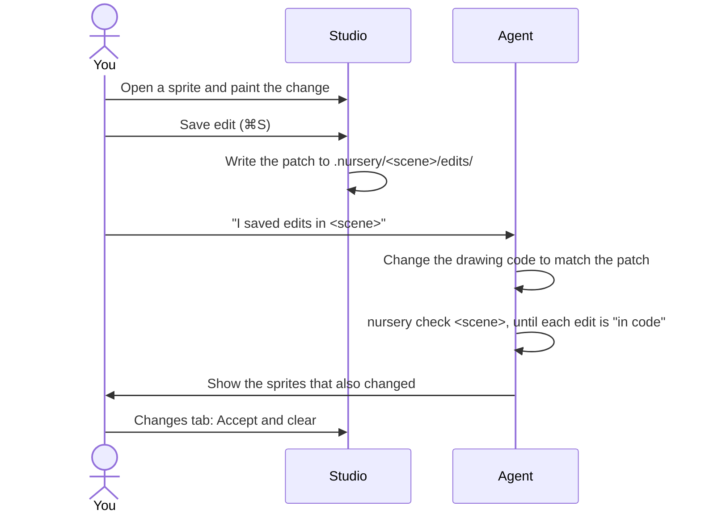
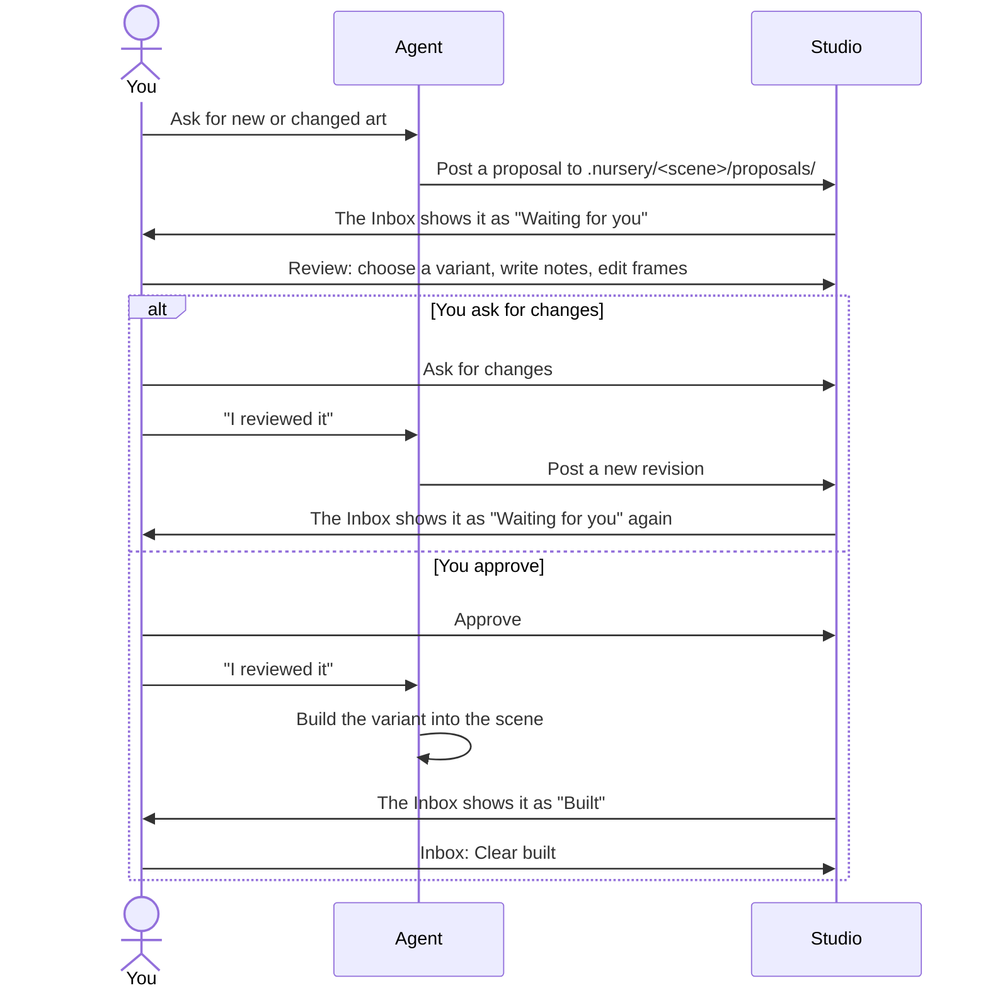
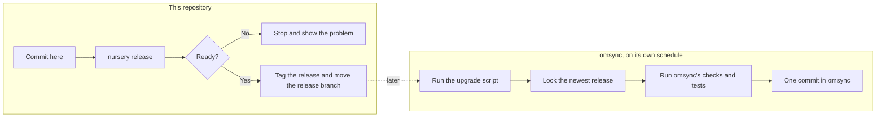

# Overview

omsync-nursery holds the pixel-art scenes for the sign-in page of omsync. It also holds the
Nursery Studio. You use the studio to look at the scenes, edit their pixels and review new art.

The owner and a coding agent do the work together. The owner decides how the art looks. The
agent changes the code. The studio is the place where each one shows work to the other.

## The parts

| Part | Where | What it does |
|---|---|---|
| Scenes | `src/nursery/assets/js/` | The engine, ten scene modules and the kit that they draw with. omsync runs this code. |
| Studio | `uv run nursery` | Shows each scene and each sprite from the code on disk. You edit pixels and review proposals here. |
| Tools | `uv run nursery --help` | `check`, `render`, `proposals`, `catalog`, `preview` and `release`. Agents use most of them. |
| Working folder | `.nursery/<scene>/` | Your saved edits, the proposals and your reviews. Git ignores this folder. |
| Catalogue | `docs/scenes/<scene>.md` | One file for each scene. It lists each element and the line of code that draws it. |
| Skill | `.claude/skills/nursery-scene/` | The design rules and the steps that agents follow. |

## Workflow 1: you edit pixels

Use this workflow when you know the change that you want. Your edit is the design, so the agent
does not make a proposal.

1. In the studio, open the sprite from Elements, the Board, a family or an icon.
2. Paint the change. Day and night change together, unless you clear that option.
3. Save the edit.
4. Tell the agent the scene name.
5. Look at the sprites that the agent shows you. A change to one frame can also change other
   frames or the young animal.
6. In the Changes tab, click Accept and clear.

## Workflow 2: the agent proposes new art

Use this workflow for new art, or when you ask for a change in words. The agent draws the art as
a proposal. A proposal shows in the studio, not in the chat.

1. Ask the agent for the change.
2. When the agent tells you, open the Inbox.
3. Compare "Now" with each variant. Play, step or slow the animation as necessary.
4. Choose a variant. Write notes for the agent.
5. If one frame is almost correct, click "Edit pixels on this frame" and paint the fix.
6. Click Approve or Ask for changes.
7. Tell the agent that you reviewed the proposal.
8. When the Inbox shows the proposal as Built, click Clear built.

## Workflow 3: release

1. Commit all changes in this repository.
2. Run `uv run nursery release --dry-run`. Correct each problem that it shows.
3. Run `uv run nursery release` with a flag: `--patch`, `--minor` or `--major`. The flag raises the
   version in `pyproject.toml`, commits it, and tags that commit `vX.Y.Z`. The first release of a
   version (`v0.1.0` today) needs no flag.

While the major version is 0, a change to the omsync contract raises the minor (`--minor`, 0.1.0 to
0.2.0). Any other change, such as a new scene or an art fix, raises the patch (`--patch`). From
1.0.0, `--major` is a contract change, `--minor` is a new scene, and `--patch` is an art fix.

The release stops when a saved edit is not in the code, or when an approved proposal is not built.
The release branch moves forward only. If it holds work that this commit does not, the release
stops. A release does not change omsync. It pushes the tag and the branch only when this
repository has a remote.

omsync takes a release when its owner runs `sh scripts/upgrade-nursery.sh` in omsync. The script
locks the newest release, runs omsync's checks and tests, and commits. Then open the omsync
sign-in page and look at the scene.

To see art in omsync before a release, run `sh scripts/dev-nursery.sh serve` in omsync. It also
shows colour changes.

## The omsync contract

omsync uses the items in this section. If you change one of them, change omsync's host code at the
same time. The host code is `static/js/controllers/nursery_controller.js`, `scene_controller.js`,
`styles/tint.css` and `styles/landing.css` in omsync.

**Package.** omsync installs this repository as the Python package `omsync-nursery`. omsync's
`pyproject.toml` names this repository by its git URL and its `release` branch. Its `uv.lock`
records the exact commit. Today the URL is a `file://` path to this checkout. omsync requires
`>=0.1,<0.2`. A contract change raises the minor, so omsync refuses it at its lock. Then omsync
must widen its range together with its host code.

**Files.** `nursery.assets` (`src/nursery/assets.py`) gives the location of three things:

- `JS`: the engine, the scenes and the kit. omsync serves this folder at `/static/vendor/nursery/`.
- `SCENES_JSON`: the id and the picker label of each scene, in picker order. omsync makes its
  scene pickers from this file. A new scene shows in omsync with no change to omsync.
- `SCENES_CSS`: the colours of each scene. omsync links this file as its own stylesheet.

**Exports.** omsync imports `Nursery`, `SCENES`, `MAX_STAGE`, `WATER_MS` and `COOLDOWN_MS` from
`nursery.js`. It imports `iconSvg` and `clamp` from `kit/pixel.js`.

**Engine.** omsync makes the engine with `{ ground, water, reducedMotion, scene, stage }`. It reads
`stage`. It calls `sprinkle(clientX, clientY)`, `setScene(scene, stage)` and `destroy()`. The
engine reads `data-theme` on `<html>` on each frame. The value "dark" is night. omsync waits
`COOLDOWN_MS` between two waterings, and its watering animation lasts `WATER_MS`.

**Scenes.** omsync reads the `id` and the `icon` of each scene. Each palette, light and dark, has
the keys `soil`, `line`, `wet`, `water` and `haze`.

**Colours.** `scenes.css` sets `--scene-tint` and `--scene-tint-dark` on `[data-tint="<id>"]`. It
sets `--landing-green`, `--landing-green-soft`, `--landing-peach`, `--landing-blush` and
`--landing-bloom` on `[data-scene="<id>"]`, with dark values under `[data-theme="dark"]`.

**Grid.** omsync sets `--landing-cell: 64px`. This value must be the art pixel size (4 px) times
the grid cell (16 art pixels).

**Ids.** The ids in `scenes.json`, `scenes.css` and `SCENES` must be the same. On the sign-in page,
omsync uses the first scene if it cannot find an id.

## Decisions

- [0001: A sibling repository](adr/0001-sibling-repository.md)
- [0002: Python and Lit](adr/0002-python-and-lit.md)
