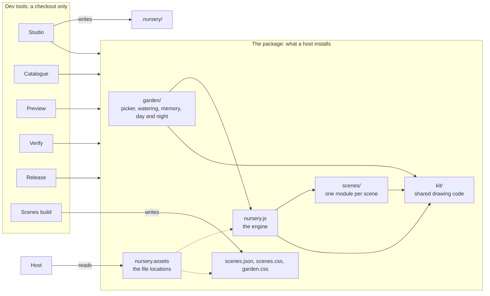
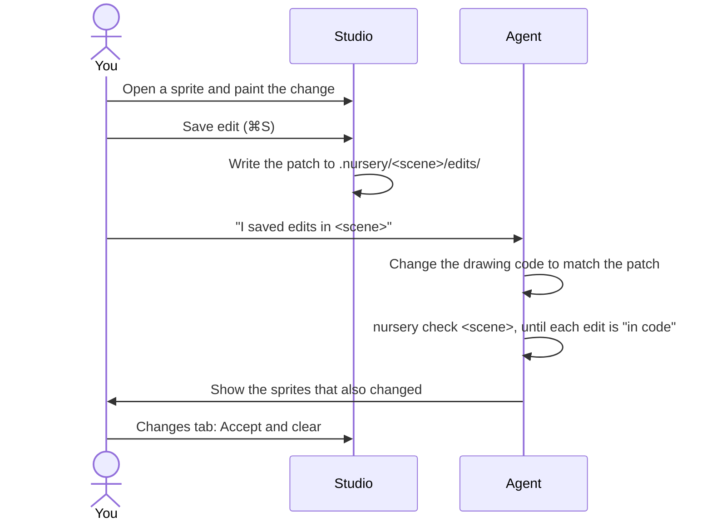
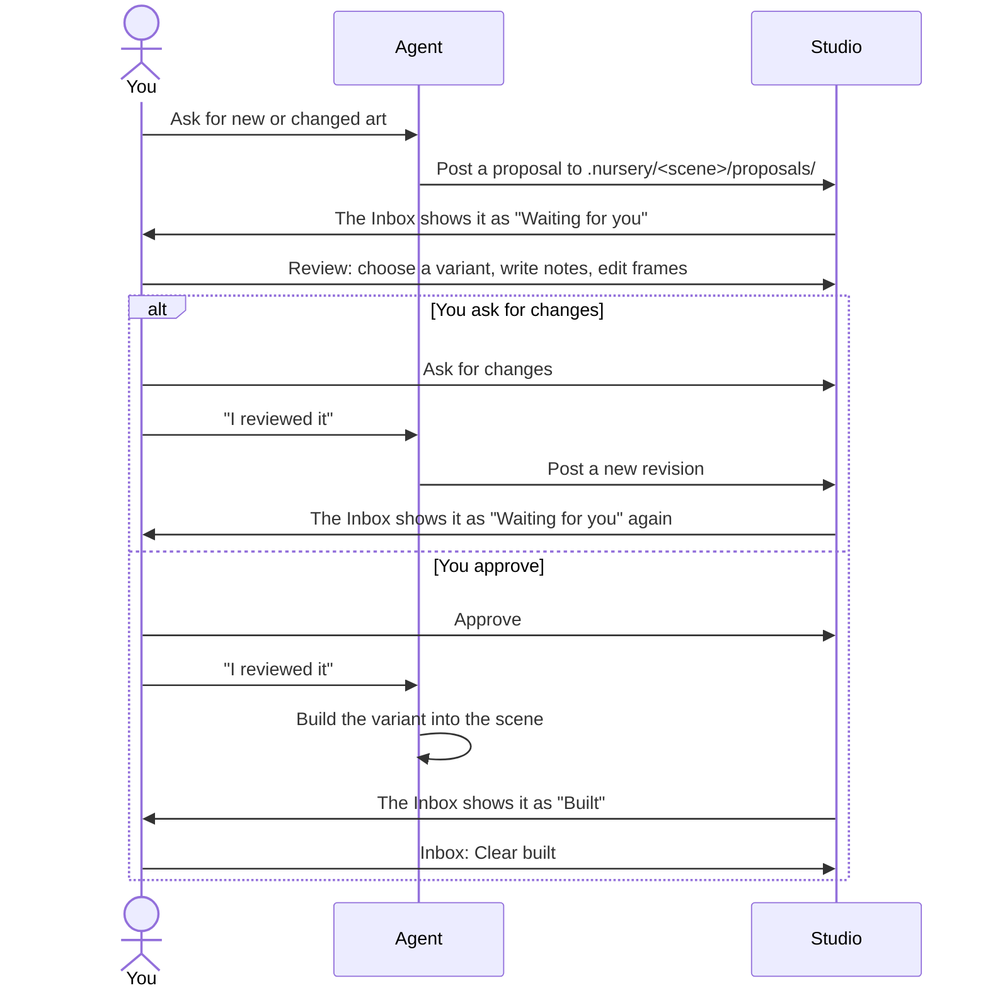
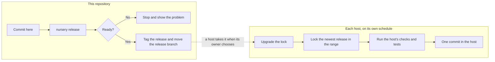
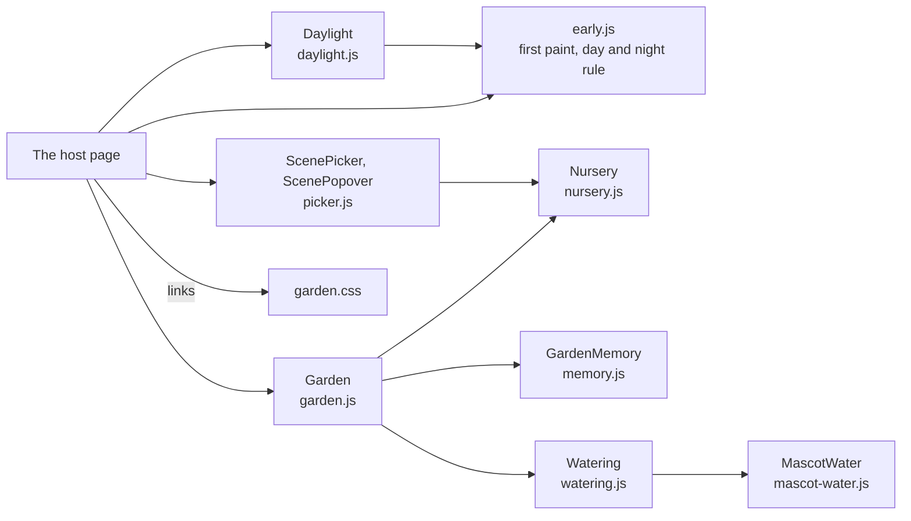

# Overview

omsync-nursery is the shared garden for the owner's apps. It holds the pixel-art scenes that grow
on a host page, and the garden around them: the scene picker, the watering, the stage sprout and
day and night. It also holds the Nursery Studio. You use the studio to look at the scenes, edit
their pixels and review new art.

A host is any app that installs this package and shows a garden. The hosts are in
[The hosts](#the-hosts). The nursery does not own a mascot. Each host brings its own mascot, and
`ink-studio` owns every mascot and favicon.

The owner and a coding agent do the work together. The owner decides how the art looks. The
agent changes the code. The studio is the place where each one shows work to the other.

## The parts

An arrow points from a part to the part that it needs. The package needs no dev tool. The garden
imports the engine and the kit. The engine imports scenes and the kit. A scene imports only the
kit. A kit module imports only the kit. Only a host imports the garden. `sh scripts/check.sh`
enforces these rules. A host reads the package through `nursery.assets` only.

| Part | Where | What it does |
|---|---|---|
| Engine, scenes and kit | `src/nursery/assets/js/` | The code that a host runs on its page. |
| Garden | `src/nursery/assets/js/garden/`, `css/garden.css` | The parts around a scene that a host shows. See [The garden](#the-garden). |
| Studio | `uv run nursery` | Shows each scene and each sprite from the code on disk. You edit pixels and review proposals here. |
| Studio mark | `src/nursery/studio/app/brand/` | The studio's own mark and favicon. `ink-studio` exports these files, as `ink.toml` lists. Do not edit them here. |
| Tools | `uv run nursery --help` | `check`, `render`, `proposals`, `catalog`, `scenes`, `preview`, `verify` and `release`. Agents use most of them. |
| Working folder | `.nursery/<scene>/` | Your saved edits, the proposals and your reviews. Git ignores this folder. |
| Skills | `.claude/skills/` | The design rules (`nursery-scene`) and verification rules (`verify-nursery`). |

## Workflow 1: you edit pixels

Use this workflow when you know the change that you want. Your edit is the design, so the agent
does not make a proposal.

1. In the studio, open the sprite from Elements, the Board, a family or an icon.
2. Paint the change. Day and night change together, unless you clear that option.
3. Save the edit.
4. Tell the agent the scene name.
5. Look at the sprites that the agent shows you. A change to one frame can also change other
   frames or the young animal.
6. In the Changes tab, click Accept and clear.

## Workflow 2: the agent proposes new art

Use this workflow for new art, or when you ask for a change in words. The agent draws the art as
a proposal. A proposal shows in the studio, not in the chat.

1. Ask the agent for the change.
2. When the agent tells you, open the Inbox.
3. Compare "Now" with each variant. Play, step or slow the animation as necessary.
4. Choose a variant. Write notes for the agent.
5. If one frame is almost correct, click "Edit pixels on this frame" and paint the fix.
6. Click Approve or Ask for changes.
7. Tell the agent that you reviewed the proposal.
8. When the Inbox shows the proposal as Built, click Clear built.

### Check the art against the rules

1. Open the Verify view and click Run verify (every scene, about 75 s) or This scene.
2. Pick a finding on the right. It plays back the frames around the failure, zoomed on the animal,
   with what the rule measured drawn over it. The red cells on the strip are the frames that fail.
3. Mark the group Real bug, Rule too strict or Ignore, and add a note. The mark applies to that
   animal and fault in every scene, and stays for later runs.
4. Tell the agent you marked findings. It reads them with `uv run nursery verify --triage`.

## Release

1. Commit all changes in this repository. Write the section for the new version in
   `CHANGELOG.md`, and do not commit it.
2. Run `uv run nursery release --dry-run`. Correct each problem that it shows.
3. Run `uv run nursery release --patch`, `--minor` or `--major`. The flag raises the version in
   `pyproject.toml`. The command commits the new version with the changelog and tags that commit
   `vX.Y.Z`. If
   `pyproject.toml` holds a version that has no tag, run the command with no flag. It releases
   that version.

[`release.py`](../src/nursery/release.py) is the full list of checks and steps. The release stops
when a saved edit is not in the code, when an approved proposal is not built, or when
`scenes.json` or `scenes.css` is stale.

**Decision: a host follows a branch.** The `main` branch holds work in progress. The `release`
branch holds only tagged releases, and it moves forward only. Each host names the branch, and its
lock file records the commit. Art reaches a host when that host upgrades, not when a commit lands
here. A host reads a checkout of this repository only for a preview before a release. The release does not change a host. It
pushes the tag and the branch only when this repository has a remote.

**Decision: the version says if a host must change.** The tag is `vX.Y.Z`, and `X.Y.Z` is the
version in `pyproject.toml`. Each host gives a version range. A contract change raises a number
that the range excludes, so the host's lock refuses the release until that host widens the range
together with its host code. Choose the flag with this table.

| Change | Major version 0 | From 1.0.0 |
|---|---|---|
| Contract change | `--minor` | `--major` |
| New scene | `--patch` | `--minor` |
| Art fix, or anything else | `--patch` | `--patch` |

## The hosts

| Host | Repository | How it takes a release | How to see art before a release |
|---|---|---|---|
| omsync | `../omsync` | `sh scripts/upgrade-nursery.sh`. It locks the newest release in the range, runs the checks and tests, and commits. | `sh scripts/dev-nursery.sh serve` |
| Mantle Reef | `../mantle` | `uv lock --upgrade-package omsync-nursery`, then `sh scripts/check.sh` and `uv run pytest -q`. | None |

**Decision: the nursery knows each host by name, not by its files.** This table tells you which
repositories a contract change touches. Each host keeps the list of its own host code. To add a
host, add a row here. The host names the `release` branch and a version range in its
`pyproject.toml`, and it gives the garden its own mascot.

## The garden

The garden is everything around a scene that a host shows. `Garden` keeps the engine, the saved
growth and the watering mascot in step. A watering saves the new stage. A scene that the user picks
again comes back at the stage where the user left it. A reset starts the scene on show again at
stage 0. The picker shows the scenes in their biome groups. `Daylight` applies light, dark or auto.

**Decision: the garden shows and reports, and the host decides what a change means.** Each host
gives its own storage keys, its mascot, the point where the water leaves the mascot, and the words
that it announces. The garden draws no mascot of its own. `Garden` calls `onChange` with the cause (`start`, `water`, `choose` or
`reset`), and the host reacts. A garden with no mascot only shows the scene.

**Decision: one script runs before first paint.** `early.js` is a classic script that the host
loads in `<head>`. It sets `data-theme` and returns the saved scene before the page is drawn, so the
colours never flash. It holds the only copy of the day and night rule. `daylight.js` uses that
rule after load.

**Decision: more scenes make the picker taller, not wider than the page.** The picker's panel has
the width of `--nursery-panel-max`, or of the window when that is narrower. The biome groups fill
as many columns as that width holds. A host puts the panel where it can grow down or up.

**Decision: the popover is the browser's own.** `ScenePopover` uses the `popover` attribute. The
browser closes it on Escape and on a click outside, and puts the focus back on its button.

**Decision: the host colours the garden.** `garden.css` reads `--nursery-ink`, `--nursery-paper`
and `--nursery-page`, with light and dark defaults. The host links `garden.css` before its own
stylesheet, so that its own rules can place the parts.

**Watering.** The engine's `sprinkle(clientX, clientY, level)` waters the scene. The `level`
argument is optional. The header of [`nursery.js`](../src/nursery/assets/js/nursery.js) gives the
numbers and the exact behavior. `Watering` waits the time in the last column before it waters
again, and drains the mascot at the speed of the spray (`releaseMs`).

| Level | Stages gained | Fountain | How long the host waits |
|---|---|---|---|
| 0 (a plain click, no `level`) | 1 | A short, upright spray. | `WATER_MS` |
| 1 to 7 | The level, up to `MAX_STAGE`. | Starts as the click's spray, then opens wider. Each level reaches farther. | `showMs(level)`, which is `releaseMs(level)` here |
| 8 | 8 | Wets the whole ground. Jets follow for `FINALE_MS`, with a mist and a rainbow. At night: a moonbow and fireflies. | `showMs(8)` |

A host can use `releaseMs(level)` to drain its water at the same speed as the spray. The rainbow,
the mist and the fireflies show on the ground canvas, behind the page. Under reduced motion the
plants grow and nothing else shows.

## The host contract

Every host uses the items in this section. If you change one of them, it is a contract change:
change the host code of each host in [The hosts](#the-hosts), each in its own repository, when
that host takes the release.

**Package.** A host installs this repository as the Python package `omsync-nursery`. Its
`pyproject.toml` names the repository by its GitHub URL and the `release` branch, and gives a
version range. Its `uv.lock` records the exact commit. A contract change raises the version past
the range. See [Release](#release).

**Files.** `nursery.assets` ([`assets.py`](../src/nursery/assets.py)) gives the location of these
things:

- `JS`: the engine, the scenes, the kit and the garden. The host serves this folder at a path of
  its choice.
- `SCENES_JSON`: the `id`, picker `label` and biome `group` of each scene, in picker order. A host
  reads the ids from this file for the first-paint script. A new scene shows in a host with no
  change to the host.
- `SCENES_CSS`: the colours of each scene.
- `GARDEN_CSS`: the styles of the garden.

**First paint.** The host loads `garden/early.js` in `<head>` and calls
`nurseryEarly.theme(key)`. A page that shows a scene sets `data-scene` from
`nurseryEarly.scene(key, ids, { first })`.

**Exports.** A host imports `Garden` from `garden/garden.js`, `GardenMemory` from
`garden/memory.js`, `ScenePicker` and `ScenePopover` from `garden/picker.js`, `Daylight` from
`garden/daylight.js`, and `MAX_STAGE` from `nursery.js`.

**Garden.** The host makes the garden with `{ ground, water, bloom, sceneId, memory, reducedMotion,
mascot, onChange, onFill }`. `mascot` is `{ button, spout, body }`. It reads `scene`, `stage` and
`stageShown`. It calls `choose(scene)`, `reset()`, `refreshMascot()` and `destroy()`.

**Picker.** The host makes a picker with `{ current, onChoose, groups, filter }`. It calls
`mark(id)` and `destroy()`.

**Classes.** The host uses the classes of `garden.css`: `nursery-backdrop` and its four layers,
`nursery-ground`, `nursery-water`, `nursery-mascot`, `nursery-controls`, `nursery-pill`,
`nursery-button`, `nursery-reset`, `nursery-stage` and `nursery-panel`. The mascot's SVG has a body
group, `.body` by default.

**Scenes.** Each palette, light and dark, has the keys `soil`, `line`, `wet`, `water` and `haze`.

**Colours.** `scenes.css` sets `--scene-tint` and `--scene-tint-dark` on `[data-tint="<id>"]`. It
sets `--landing-green`, `--landing-green-soft`, `--landing-peach`, `--landing-blush` and
`--landing-bloom` on `[data-scene="<id>"]`, with dark values under `[data-theme="dark"]`. The engine
reads `data-theme` on `<html>` on each frame. The value "dark" is night.

**Grid.** `scenes.css` sets `--landing-cell: 64px` on `:root`. This value must be the art pixel size
(4 px) times the grid cell (16 art pixels).

**Ids.** The ids in `scenes.json`, `scenes.css` and `SCENES` must be the same. `Garden` uses the
first scene if it cannot find an id.

## Decisions

- [0001: A sibling repository](adr/0001-sibling-repository.md)
- [0002: Python and Lit](adr/0002-python-and-lit.md)
